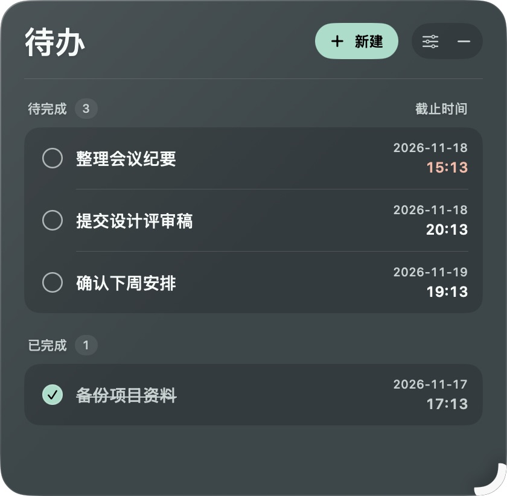
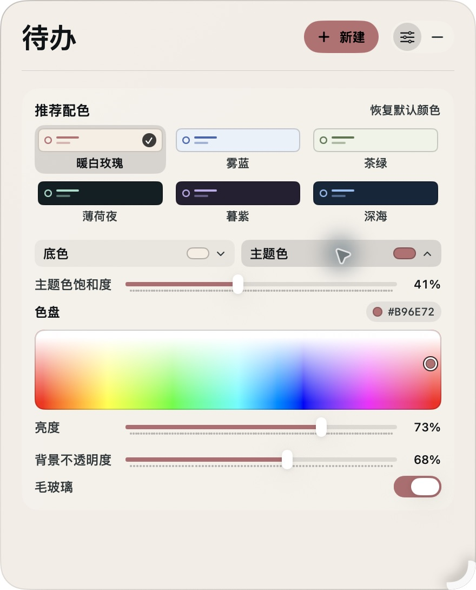

# Floating Todo List（悬浮代办事项）

一个原生 macOS 待办清单，窗口可悬浮在其他应用上方。拖动标题区域移动窗口，拖动底部角标调整大小。菜单栏的清单图标可以隐藏、显示窗口或退出应用。

- 点击「新建」添加待办和截止日期、时间。点击条目可以修改，点击圆圈可以完成或恢复。逾期的待办会高亮显示。
- 在「外观设置」中调整背景不透明度，开关毛玻璃，选择推荐配色或自定义底色与主题色。

## 界面截图

### 待办清单与外观设置

<p>
  
  
</p>

### 紧凑悬浮窗口


## 构建和运行

需要 macOS 14 或更新版本，以及 Xcode Command Line Tools。首次安装命令行工具可运行 `xcode-select --install`。

在仓库目录运行下面两条命令。

```bash
bash ./build.sh
open "$HOME/Applications/悬浮待办.app"
```

应用可离线使用，构建使用系统自带框架。待办、外观和窗口位置与大小保存在当前 macOS 用户的应用偏好中，应用偏好标识为 `local.floatingtodo`。
